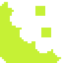
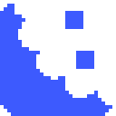
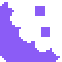
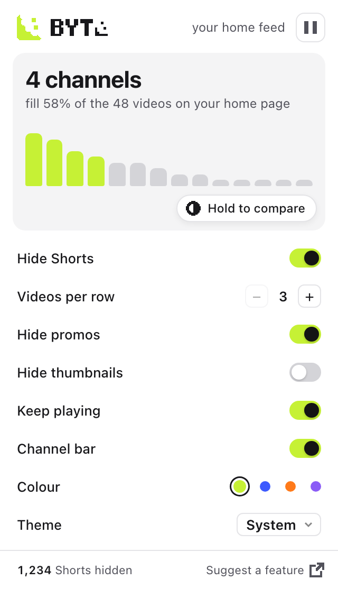
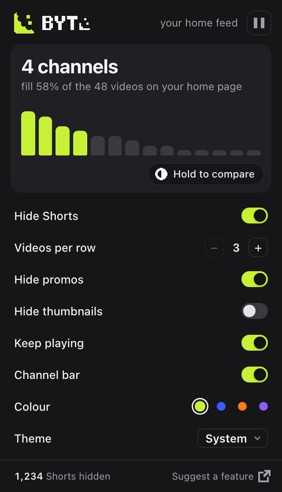
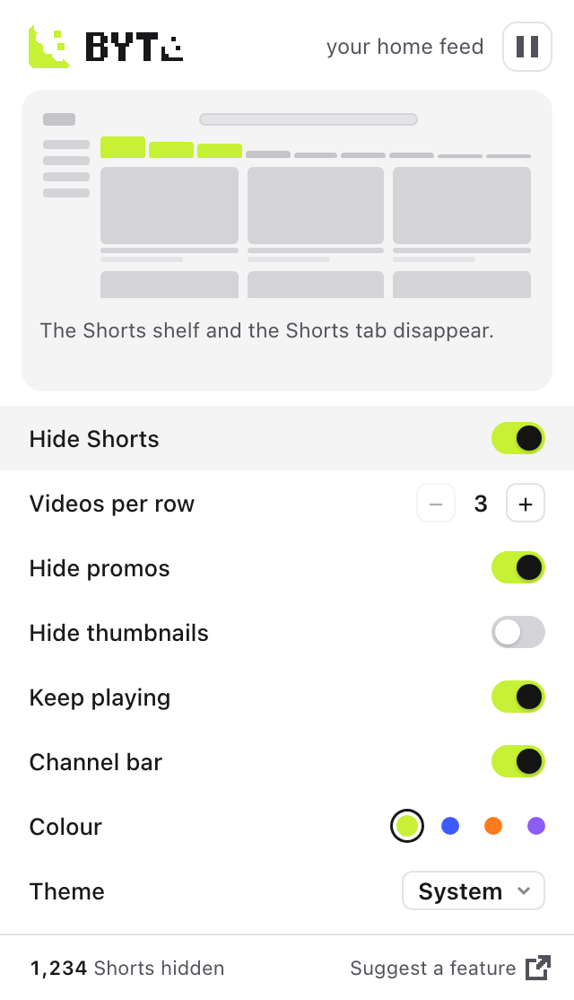
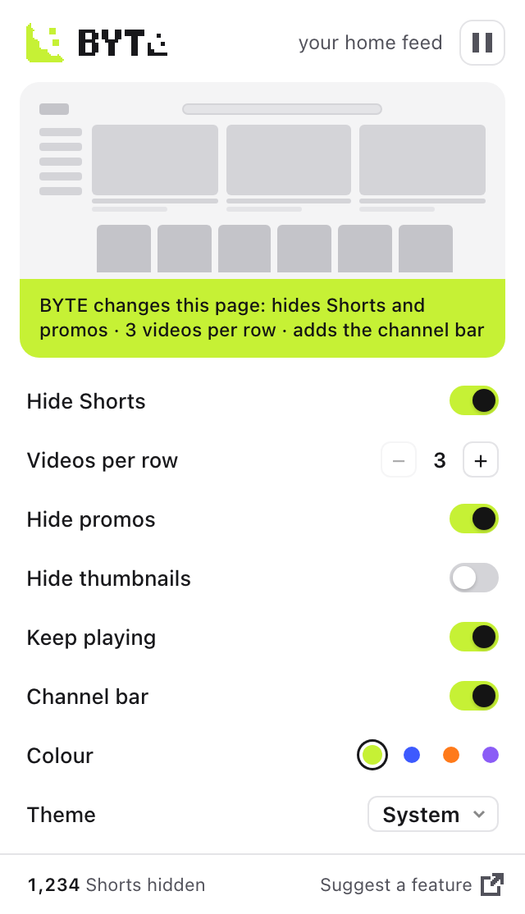
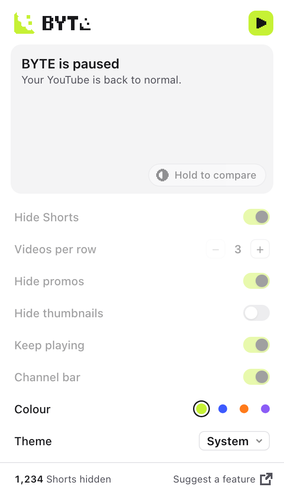

# BYTE design system

Everything BYTE looks like, in one place. This folder is dev-only (`web-ext-config.cjs` ignores it), so nothing here ships in the extension. The code is the source of truth: each asset below is generated from it, so it can't drift.

| What | Where | Source of truth | Regenerate |
|---|---|---|---|
| Mark and wordmark | `brand/` | `lib/mark.js` | `node scripts/generate-icons.js` |
| Extension icons (16/32/48/128 PNG) | `../icons/` | `lib/mark.js` | `node scripts/generate-icons.js` |
| UI icons (compare, external, pause, play) | `ui-icons/` (sources in `ui-icons/source/`) | `../icons.yaml` (draw-icons DNA) | draw-icons skill: `node <skill>/scripts/icons.js build` |
| Popup screenshots | `screenshots/popup/` | `popup/` | `npm run screenshots` |

`npm test` fails if the committed icons or brand SVGs differ from what `lib/mark.js` draws.

## Brand

- **Name:** BYTE, short for **B**etter **Y**ou**T**ube **E**xperience. Never "YouTube" in the name, no YouTube red, and no play-button shapes.
- **Mark:** a rounded tile with a large bite out of its top-right corner and two crumbs. It has no letter and is drawn on a pixel grid with no anti-aliasing. The parameters are fixed in `ByteMark.MARK_PARAMS`: `size 13.2 · pos 0.52 · teeth 5 · tooth 0.18 · smooth 0 · crumbs 2 · csize 2.5 · round 2.6 · grid 32`.
  - The same parameters apply at every size: a 16 grid at 16px, a 32 grid from 32px up.
  - The store icon (128px) is the mark at 96px, centred, with 16px of transparent padding.
- **Wordmark:** "BYTE" in 6×8 pixel caps with 2px stems. The E gets the same bite, scaled by 0.5, which eats most of it.

| Mark (lime) | Cobalt | Tangerine | Violet | Wordmark |
|---|---|---|---|---|
|  |  |  |  |  |

## Colour

There are four accents, in `ByteCore.PALETTES`. **Lime is the default** for every install and for the store. The toolbar icon follows the chosen accent.

| id | accent | text on accent |
|---|---|---|
| lime | `#C6F135` | `#141414` |
| cobalt | `#3D5AFE` | `#FFFFFF` |
| tangerine | `#FF7A1A` | `#1A1208` |
| violet | `#8B5CF6` | `#FFFFFF` |

Colour is the frosting, not the cake. Accents appear only where they mean something: the "loop" channels in the chart and on the page, switches that are on, the compare summary strip, and the icon.

**Neutral tokens** are in `popup/popup.css` `:root`. Each is written once as `light-dark(light, dark)`. The popup follows the OS unless the Theme setting (`byte_theme`: system / light / dark) forces a scheme.

| token | light | dark | used for |
|---|---|---|---|
| `--paper` | `#ffffff` | `#161618` | background |
| `--ink` | `#18181b` | `#f4f4f5` | primary text |
| `--ink2` | `#52525b` | `#a1a1aa` | secondary text |
| `--ink3` | `#a1a1aa` | `#71717a` | tertiary text, hints |
| `--line` | `#e4e4e7` | `#2a2a2e` | dividers, borders |
| `--wash` | `#f4f4f5` | `#202024` | the window, hover rows |
| `--bar` / `--off` | `#d4d4d8` | `#3a3a40` | grey chart bars, switches that are off |
| `--b1`…`--b3` | `#e4e4e7`…`#c4c4c9` | `#2a2a2e`…`#44444c` | wireframe greys |

The channel bar on YouTube uses YouTube's own `--yt-sys-color-baseline--*` variables, with dark fallbacks, so it matches both of YouTube's themes.

## Type, spacing, motion

- **Type:** the system UI font (`-apple-system`, Inter, Segoe UI, Roboto). The wordmark is the only pixel type.
- **Size:** the popup is 320px wide. Rows have equal heights, and controls sit on one right edge.
- **UI icons:** pixel art on a 16 grid with 2px strokes (matching the wordmark's stems), drawn in `currentColor`. Show them **only at 16px**.
- **Motion:** `--ease: cubic-bezier(.2, .8, .2, 1)`.
  - Switches snap (`--snap`, 150ms).
  - A colour change re-tints smoothly (`--tint`, 350ms), the one moment of delight.
  - Hover previews loop: outline the part (450ms), change it (1150ms), restart (3200ms).
  - `prefers-reduced-motion` shows end states without animating.

## Principles

- Show, don't tell: little text, plain language, previews of what each setting does.
- Every setting is a real off-switch, and off means off.
- State is visible at a glance: the mirror stat, the channel bar, the paused state.
- Motion explains change; delight is saved for rare moments.
- Polish everywhere. Don't look like a dense settings dump, and don't look affiliated with YouTube.

## Popup screenshots

These are made with sample data (a stubbed Home feed), not a real account.

| At rest | Dark | Hover: Hide Shorts | Hold to compare | Paused |
|---|---|---|---|---|
|  |  |  |  |  |

All 19 states, including every hover preview, each accent, the forced themes and the fallbacks, are in [`screenshots/popup/`](screenshots/popup/).
